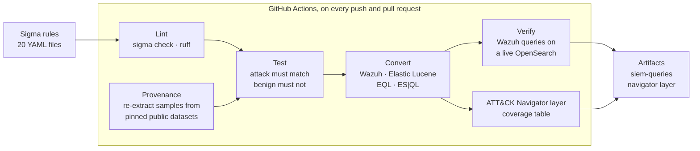

# Detection as Code

[](https://github.com/Barkatzineddine/detection-as-code/actions/workflows/detections.yml)
[](https://github.com/Barkatzineddine/detection-as-code/actions/workflows/codeql.yml)
[](LICENSE)

**SOC detections managed like code.** Twenty [Sigma](https://sigmahq.io) rules for Windows and
Linux, each mapped to MITRE ATT&CK and shipped with a triage playbook. A rule is only merged
when CI proves that it **fires on a recorded real attack** and **stays silent on every benign
sample** in the repository. The same rules are then converted for **Wazuh** and **Elastic**,
and the Wazuh queries are run against a live OpenSearch to prove the conversion too.

The attack samples are not written by hand: they are extracted from public datasets of
recorded attacks ([OTRF Security-Datasets](https://github.com/OTRF/Security-Datasets),
[loghub](https://github.com/logpai/loghub)), and CI rebuilds them from the pinned sources on
every push.

## Pipeline



| Stage | Tool | The build fails when |
|---|---|---|
| Rule quality | `sigma check` (pySigma validators), ruff | a rule is invalid, uses a wrong ATT&CK tag or a risky modifier combination; Python lint or format issues |
| Detection tests | pytest + pySigma SQLite backend | a rule misses one event of its recorded attack, or fires on any benign sample |
| Sample provenance | `tools/build_samples.py --check` | a sample differs from what the pinned dataset (URL at a fixed commit + SHA-256) produces |
| Conversion | pySigma Elasticsearch and OpenSearch backends | a rule cannot be converted; the coverage table or Navigator layer is out of date |
| Live verification | OpenSearch 2.19 (the Wazuh 4.x indexer engine), pinned by digest | a converted Wazuh query misses an attack event or matches a benign one |
| Code scanning | CodeQL `security-extended` | a security finding in the Python code or the workflows |

## How a rule is tested

Each rule has a folder in [`tests/data/`](tests/data):

- `attack.json` (or `.log`): the events of the recorded attack. **Every** event must match.
- `benign.json` (or `.log`): real events of the same type that must not match (system
  activity, admin tools, near misses).

The test harness ([`dac/engine.py`](dac/engine.py)) compiles each rule with pySigma's SQLite
backend, the engine behind [Zircolite](https://github.com/wagga40/Zircolite), and runs it
against an in-memory table built from the events. The same processing pipelines a SIEM would
use scope each rule to its log source (`process_creation` becomes `EventID 1` on the Sysmon
channel, and so on), so a rule is only ever matched against events of its own type. Sigma
correlation rules, used for the SSH brute force, run natively.

Every rule runs against **every** benign file, not only its own: 20 rules × 21 benign files,
188 benign events including 98 events of background activity from the lab hosts
([`_baseline`](tests/data/_baseline/benign.json)). The suite has 506 tests and runs in
2 seconds.

## Coverage

<!-- coverage:start -->
20 rules, 25 ATT&CK techniques (ATT&CK v20). Rules per tactic: Execution **4** · Persistence **5** · Privilege Escalation **5** · Stealth **5** · Defense Impairment **4** · Credential Access **7** · Discovery **1** · Lateral Movement **1** · Command And Control **1**.

| Rule | ATT&CK | Log source | Level | Recorded attack | Triage |
|---|---|---|---|---|---|
| [File Transfer Started With bitsadmin](rules/windows/process_creation/proc_creation_win_bitsadmin_download.yml) | [T1197](https://attack.mitre.org/techniques/T1197/) BITS Jobs, [T1105](https://attack.mitre.org/techniques/T1105/) Ingress Tool Transfer | windows / process_creation | medium | [cmd_bitsadmin_download_psh_script](https://raw.githubusercontent.com/OTRF/Security-Datasets/d9d40ef123d2c87d5d3df28c96bcab4f0faccc87/datasets/atomic/windows/defense_evasion/host/cmd_bitsadmin_download_psh_script.zip) | [playbook](playbooks/proc_creation_win_bitsadmin_download.md) |
| [PowerShell Started With an Encoded Command](rules/windows/process_creation/proc_creation_win_powershell_encoded_cmd.yml) | [T1059.001](https://attack.mitre.org/techniques/T1059/001/) PowerShell, [T1027.010](https://attack.mitre.org/techniques/T1027/010/) Command Obfuscation | windows / process_creation | high | [empire_launcher_vbs](https://raw.githubusercontent.com/OTRF/Security-Datasets/d9d40ef123d2c87d5d3df28c96bcab4f0faccc87/datasets/atomic/windows/execution/host/empire_launcher_vbs.zip), [empire_smbexec_dcerpc_smb_svcctl](https://raw.githubusercontent.com/OTRF/Security-Datasets/d9d40ef123d2c87d5d3df28c96bcab4f0faccc87/datasets/atomic/windows/lateral_movement/host/empire_smbexec_dcerpc_smb_svcctl.zip), [empire_uac_shellapi_fodhelper](https://raw.githubusercontent.com/OTRF/Security-Datasets/d9d40ef123d2c87d5d3df28c96bcab4f0faccc87/datasets/atomic/windows/privilege_escalation/host/empire_uac_shellapi_fodhelper.zip) | [playbook](playbooks/proc_creation_win_powershell_encoded_cmd.md) |
| [Scheduled Task Created With a Suspicious Action or SYSTEM Context](rules/windows/process_creation/proc_creation_win_schtasks_create_suspicious.yml) | [T1053.005](https://attack.mitre.org/techniques/T1053/005/) Scheduled Task | windows / process_creation | medium | [schtask_create](https://raw.githubusercontent.com/OTRF/Security-Datasets/d9d40ef123d2c87d5d3df28c96bcab4f0faccc87/datasets/atomic/windows/lateral_movement/host/schtask_create.zip), [empire_schtasks_creation_standard_user](https://raw.githubusercontent.com/OTRF/Security-Datasets/d9d40ef123d2c87d5d3df28c96bcab4f0faccc87/datasets/atomic/windows/persistence/host/empire_schtasks_creation_standard_user.zip) | [playbook](playbooks/proc_creation_win_schtasks_create_suspicious.md) |
| [Service Installed With a Shell or Script Command as Its Binary](rules/windows/builtin/security/win_security_service_install_suspicious.yml) | [T1543.003](https://attack.mitre.org/techniques/T1543/003/) Windows Service, [T1569.002](https://attack.mitre.org/techniques/T1569/002/) Service Execution, [T1021.002](https://attack.mitre.org/techniques/T1021/002/) SMB/Windows Admin Shares | windows / security | high | [empire_psexec_dcerpc_tcp_svcctl](https://raw.githubusercontent.com/OTRF/Security-Datasets/d9d40ef123d2c87d5d3df28c96bcab4f0faccc87/datasets/atomic/windows/lateral_movement/host/empire_psexec_dcerpc_tcp_svcctl.zip), [empire_smbexec_dcerpc_smb_svcctl](https://raw.githubusercontent.com/OTRF/Security-Datasets/d9d40ef123d2c87d5d3df28c96bcab4f0faccc87/datasets/atomic/windows/lateral_movement/host/empire_smbexec_dcerpc_smb_svcctl.zip) | [playbook](playbooks/win_security_service_install_suspicious.md) |
| [Run Key Value Launching a Script Interpreter or Payload](rules/windows/registry/registry_set/registry_set_win_run_key_suspicious.yml) | [T1547.001](https://attack.mitre.org/techniques/T1547/001/) Registry Run Keys / Startup Folder | windows / registry_set | medium | [empire_persistence_registry_modification_run_keys_standard_user](https://raw.githubusercontent.com/OTRF/Security-Datasets/d9d40ef123d2c87d5d3df28c96bcab4f0faccc87/datasets/atomic/windows/persistence/host/empire_persistence_registry_modification_run_keys_standard_user.zip) | [playbook](playbooks/registry_set_win_run_key_suspicious.md) |
| [WMI Event Consumer Running a Command or Script](rules/windows/wmi_event/wmi_event_win_commandline_consumer.yml) | [T1546.003](https://attack.mitre.org/techniques/T1546/003/) Windows Management Instrumentation Event Subscription | windows / wmi_event | high | [empire_wmi_local_event_subscriptions_elevated_user](https://raw.githubusercontent.com/OTRF/Security-Datasets/d9d40ef123d2c87d5d3df28c96bcab4f0faccc87/datasets/atomic/windows/persistence/host/empire_wmi_local_event_subscriptions_elevated_user.zip) | [playbook](playbooks/wmi_event_win_commandline_consumer.md) |
| [UAC Bypass Through the ms-settings Protocol Handler](rules/windows/registry/registry_set/registry_set_win_uac_bypass_ms_settings.yml) | [T1548.002](https://attack.mitre.org/techniques/T1548/002/) Bypass User Account Control | windows / registry_set | high | [empire_uac_shellapi_fodhelper](https://raw.githubusercontent.com/OTRF/Security-Datasets/d9d40ef123d2c87d5d3df28c96bcab4f0faccc87/datasets/atomic/windows/privilege_escalation/host/empire_uac_shellapi_fodhelper.zip) | [playbook](playbooks/registry_set_win_uac_bypass_ms_settings.md) |
| [Mshta Executing Inline Script or a Remote HTA](rules/windows/process_creation/proc_creation_win_mshta_inline_script.yml) | [T1218.005](https://attack.mitre.org/techniques/T1218/005/) Mshta | windows / process_creation | high | [cmd_mshta_vbscript_execute_psh](https://raw.githubusercontent.com/OTRF/Security-Datasets/d9d40ef123d2c87d5d3df28c96bcab4f0faccc87/datasets/atomic/windows/defense_evasion/host/cmd_mshta_vbscript_execute_psh.zip) | [playbook](playbooks/proc_creation_win_mshta_inline_script.md) |
| [Regsvr32 Loading a Scriptlet (Squiblydoo)](rules/windows/process_creation/proc_creation_win_regsvr32_remote_scriptlet.yml) | [T1218.010](https://attack.mitre.org/techniques/T1218/010/) Regsvr32 | windows / process_creation | high | [empire_launcher_sct_regsvr32](https://raw.githubusercontent.com/OTRF/Security-Datasets/d9d40ef123d2c87d5d3df28c96bcab4f0faccc87/datasets/atomic/windows/defense_evasion/host/empire_launcher_sct_regsvr32.zip) | [playbook](playbooks/proc_creation_win_regsvr32_remote_scriptlet.md) |
| [LSASS Dump via comsvcs.dll MiniDump](rules/windows/process_creation/proc_creation_win_rundll32_comsvcs_minidump.yml) | [T1003.001](https://attack.mitre.org/techniques/T1003/001/) LSASS Memory, [T1218.011](https://attack.mitre.org/techniques/T1218/011/) Rundll32 | windows / process_creation | critical | [psh_lsass_memory_dump_comsvcs](https://raw.githubusercontent.com/OTRF/Security-Datasets/d9d40ef123d2c87d5d3df28c96bcab4f0faccc87/datasets/atomic/windows/credential_access/host/psh_lsass_memory_dump_comsvcs.zip) | [playbook](playbooks/proc_creation_win_rundll32_comsvcs_minidump.md) |
| [Audit Policy Disabled or Cleared With auditpol](rules/windows/process_creation/proc_creation_win_auditpol_disable_logging.yml) | [T1685.001](https://attack.mitre.org/techniques/T1685/001/) Disable or Modify Windows Event Log | windows / process_creation | high | [auditpol_system_user_auditpolicy_modification](https://raw.githubusercontent.com/OTRF/Security-Datasets/d9d40ef123d2c87d5d3df28c96bcab4f0faccc87/datasets/atomic/windows/defense_evasion/host/auditpol_system_user_auditpolicy_modification.zip) | [playbook](playbooks/proc_creation_win_auditpol_disable_logging.md) |
| [Firewall Rule Allowing Inbound Traffic Added With netsh](rules/windows/process_creation/proc_creation_win_netsh_firewall_allow_inbound.yml) | [T1686.003](https://attack.mitre.org/techniques/T1686/003/) Windows Host Firewall | windows / process_creation | medium | [cmd_netsh_fw_mod_open_ports](https://raw.githubusercontent.com/OTRF/Security-Datasets/d9d40ef123d2c87d5d3df28c96bcab4f0faccc87/datasets/atomic/windows/defense_evasion/host/cmd_netsh_fw_mod_open_ports.zip) | [playbook](playbooks/proc_creation_win_netsh_firewall_allow_inbound.md) |
| [Windows Event Log Service Disabled in the Registry](rules/windows/registry/registry_set/registry_set_win_eventlog_service_disabled.yml) | [T1685.001](https://attack.mitre.org/techniques/T1685/001/) Disable or Modify Windows Event Log | windows / registry_set | high | [cmd_disable_eventlog_service_startuptype_modification_via_registry](https://raw.githubusercontent.com/OTRF/Security-Datasets/d9d40ef123d2c87d5d3df28c96bcab4f0faccc87/datasets/atomic/windows/defense_evasion/host/cmd_disable_eventlog_service_startuptype_modification_via_registry.zip) | [playbook](playbooks/registry_set_win_eventlog_service_disabled.md) |
| [Security Event Log Cleared](rules/windows/builtin/security/win_security_audit_log_cleared.yml) | [T1685.005](https://attack.mitre.org/techniques/T1685/005/) Clear Windows Event Logs | windows / security | high | [cmd_bitsadmin_download_psh_script](https://raw.githubusercontent.com/OTRF/Security-Datasets/d9d40ef123d2c87d5d3df28c96bcab4f0faccc87/datasets/atomic/windows/defense_evasion/host/cmd_bitsadmin_download_psh_script.zip), [psh_lsass_memory_dump_comsvcs](https://raw.githubusercontent.com/OTRF/Security-Datasets/d9d40ef123d2c87d5d3df28c96bcab4f0faccc87/datasets/atomic/windows/credential_access/host/psh_lsass_memory_dump_comsvcs.zip) | [playbook](playbooks/win_security_audit_log_cleared.md) |
| [SSH Logins Tried for Many User Names From a Single Source](rules/linux/sshd/lnx_sshd_invalid_user_enumeration.yml) | [T1110.003](https://attack.mitre.org/techniques/T1110/003/) Password Spraying, [T1087](https://attack.mitre.org/techniques/T1087/) Account Discovery | linux / sshd | medium | [OpenSSH_2k](https://raw.githubusercontent.com/logpai/loghub/dd61d0952749ee7963bde24220d1be5ede023033/OpenSSH/OpenSSH_2k.log) | [playbook](playbooks/lnx_sshd_invalid_user_enumeration.md) |
| [SSH Password Brute Force From a Single Source](rules/linux/sshd/lnx_sshd_password_bruteforce.yml) | [T1110.001](https://attack.mitre.org/techniques/T1110/001/) Password Guessing | linux / sshd | medium | [OpenSSH_2k](https://raw.githubusercontent.com/logpai/loghub/dd61d0952749ee7963bde24220d1be5ede023033/OpenSSH/OpenSSH_2k.log) | [playbook](playbooks/lnx_sshd_password_bruteforce.md) |
| [Suspicious Process Access to LSASS Memory](rules/windows/process_access/proc_access_win_lsass_suspicious_access.yml) | [T1003.001](https://attack.mitre.org/techniques/T1003/001/) LSASS Memory | windows / process_access | high | [empire_mimikatz_logonpasswords](https://raw.githubusercontent.com/OTRF/Security-Datasets/d9d40ef123d2c87d5d3df28c96bcab4f0faccc87/datasets/atomic/windows/credential_access/host/empire_mimikatz_logonpasswords.zip) | [playbook](playbooks/proc_access_win_lsass_suspicious_access.md) |
| [Active Directory Database Copied With ntdsutil IFM](rules/windows/process_creation/proc_creation_win_ntdsutil_ifm_dump.yml) | [T1003.003](https://attack.mitre.org/techniques/T1003/003/) NTDS | windows / process_creation | high | [cmd_dumping_ntds_dit_file_ntdsutil](https://raw.githubusercontent.com/OTRF/Security-Datasets/d9d40ef123d2c87d5d3df28c96bcab4f0faccc87/datasets/atomic/windows/credential_access/host/cmd_dumping_ntds_dit_file_ntdsutil.zip) | [playbook](playbooks/proc_creation_win_ntdsutil_ifm_dump.md) |
| [SAM, SYSTEM or SECURITY Hive Saved With reg.exe](rules/windows/process_creation/proc_creation_win_reg_save_sensitive_hive.yml) | [T1003.002](https://attack.mitre.org/techniques/T1003/002/) Security Account Manager, [T1003.004](https://attack.mitre.org/techniques/T1003/004/) LSA Secrets | windows / process_creation | high | [empire_shell_reg_dump_sam](https://raw.githubusercontent.com/OTRF/Security-Datasets/d9d40ef123d2c87d5d3df28c96bcab4f0faccc87/datasets/atomic/windows/credential_access/host/empire_shell_reg_dump_sam.zip) | [playbook](playbooks/proc_creation_win_reg_save_sensitive_hive.md) |
| [Directory Replication Requested by a Non-Machine Account (DCSync)](rules/windows/builtin/security/win_security_dcsync_replication_request.yml) | [T1003.006](https://attack.mitre.org/techniques/T1003/006/) DCSync | windows / security | high | [empire_dcsync_dcerpc_drsuapi_DsGetNCChanges](https://raw.githubusercontent.com/OTRF/Security-Datasets/d9d40ef123d2c87d5d3df28c96bcab4f0faccc87/datasets/atomic/windows/credential_access/host/empire_dcsync_dcerpc_drsuapi_DsGetNCChanges.zip) | [playbook](playbooks/win_security_dcsync_replication_request.md) |
<!-- coverage:end -->

The [ATT&CK Navigator layer](docs/attack-navigator-layer.json) is generated from the rule tags
by [`tools/coverage.py`](tools/coverage.py), together with this table.
[Open it in the Navigator](https://mitre-attack.github.io/attack-navigator/#layerURL=https%3A%2F%2Fraw.githubusercontent.com%2FBarkatzineddine%2Fdetection-as-code%2Fmain%2Fdocs%2Fattack-navigator-layer.json).

## One rule end to end: LSASS memory access

**1. The rule** ([`proc_access_win_lsass_suspicious_access.yml`](rules/windows/process_access/proc_access_win_lsass_suspicious_access.yml)).
Sysmon event 10 records every handle opened to another process. Reading credentials from
LSASS requires `PROCESS_VM_READ` (`0x10`); tools that load themselves in memory, such as
Invoke-Mimikatz, also leave an `UNKNOWN` frame in the call stack because their code is not
backed by a file on disk.

```yaml
detection:
  selection_target:
    TargetImage|endswith: '\lsass.exe'
  selection_access:
    GrantedAccess: ['0x1010', '0x1410', '0x1418', '0x1438', '0x143a', '0x1f0fff', '0x1fffff', ...]
  selection_unbacked_code:
    CallTrace|contains: 'UNKNOWN('
  filter_main_windows:
    SourceImage: ['C:\Windows\System32\csrss.exe', 'C:\Windows\System32\wininit.exe', ...]
  filter_optional_defender:
    SourceImage|endswith: '\MsMpEng.exe'   # under the Defender install folders only
  condition: selection_target and (selection_access or selection_unbacked_code) and not 1 of filter_*
```

**2. The recorded attack** ([`attack.json`](tests/data/proc_access_win_lsass_suspicious_access/attack.json)),
from the OTRF dataset `empire_mimikatz_logonpasswords`: an Empire agent running
Invoke-Mimikatz `sekurlsa::logonpasswords` on `WORKSTATION5`.

```json
{
  "EventID": 10,
  "SourceImage": "C:\\windows\\System32\\WindowsPowerShell\\v1.0\\powershell.exe",
  "TargetImage": "C:\\windows\\system32\\lsass.exe",
  "GrantedAccess": "0x1010",
  "CallTrace": "C:\\windows\\SYSTEM32\\ntdll.dll+9c534|C:\\windows\\System32\\KERNELBASE.dll+2726e|UNKNOWN(000002EE319439BF)"
}
```

**3. The benign baseline** ([`benign.json`](tests/data/proc_access_win_lsass_suspicious_access/benign.json)).
The same hosts open LSASS all the time: `svchost.exe` with `0x1000`, `0x2000` and `0x3000`
(Local Session Manager, SysMain), `VBoxService.exe` with `0x1400`. None of these rights
include memory read, so the rule stays silent. It is also silent on the 183 other benign
events of the repository.

**4. The test.** `pytest -k lsass` runs the rule against the attack (1/1 events matched) and
against the 21 benign files (0 alerts).

**5. The conversions** (CI artifact `siem-queries`). For the Wazuh indexer:

```
data.win.system.channel:Microsoft\-Windows\-Sysmon\/Operational AND (data.win.system.eventID:10 AND
(data.win.eventdata.targetImage:*\\lsass.exe AND ((data.win.eventdata.grantedAccess:(0x1010 OR ...))
OR data.win.eventdata.callTrace:*UNKNOWN\(*) AND (NOT (...))))
```

and for Elastic, as EQL on ECS fields:

```
any where winlog.channel:"Microsoft-Windows-Sysmon/Operational" and (event.code:"10" and
(winlog.event_data.TargetImage:"*\\lsass.exe" and ((winlog.event_data.GrantedAccess like~ ("0x1010", ...))
or winlog.event_data.CallTrace:"*UNKNOWN(*") and (not (...))))
```

**6. The live check.** CI indexes the 441 sample events into OpenSearch 2.19 in the document
shape Wazuh's decoders produce, then runs the Wazuh query: it returns the Mimikatz event and
nothing else, with both the case-insensitive and the case-sensitive mapping.

**7. The analyst's side.** The [playbook](playbooks/proc_access_win_lsass_suspicious_access.md)
explains how to read `GrantedAccess` and `CallTrace`, what to look at next (dump files,
sessions on the host), the expected false positives (EDR and backup agents) and the response
(treat every credential cached on the host as stolen).

## What building it surfaced

Real findings from this repository's own history:

1. **ATT&CK v20 renumbered half of Defense Evasion.** `sigma check` rejected 14 tags on the
   first run. ATT&CK v20 split the tactic into *Stealth* and *Defense Impairment*, and moved
   techniques such as Clear Windows Event Logs (T1070.001 → [T1685.005](https://attack.mitre.org/techniques/T1685/005/))
   and Disable or Modify System Firewall (T1562.004 → [T1686.003](https://attack.mitre.org/techniques/T1686/003/)).
   Rules tagged from memory would have produced a Navigator layer full of techniques that no
   longer exist. The ATT&CK data used for the coverage is now pinned to the v20 release.
2. **A modifier combination that silently breaks a rule.** The validator flagged
   `CommandLine|windash|contains|all` in the scheduled-task rule: `windash` expands each value
   into five dash variants, and `all` then requires *all* of them at once, so the selection
   could never match. Rewritten as `windash|contains` with full values.
3. **The datasets themselves were quarantined.** Microsoft Defender removed five of the
   extracted OTRF files, recognising the Base64-encoded Empire stagers inside the logs.
   Anyone cloning a repository that contains them would have the same problem. The sample
   builder now reads events straight from the archives and truncates long encoded payloads,
   which no rule depends on ([details](tests/data/README.md#edits-made-to-recorded-events)).
4. **Converted queries that silently stop matching in Wazuh.** Sigma compares strings
   case-insensitively, but Wazuh's index template stores event fields as case-sensitive
   keywords. Run against a live OpenSearch with that mapping, 3 of the 20 Wazuh queries miss
   their recorded attack: `reg save HKLM\sam` does not match `hklm\sam`, `schtasks /Create`
   does not match `/create`, and the service-install events were shipped with the channel
   name `security` while the query asks for `Security`. With a lowercase normalizer on the index, all 20 match their attack and
   nothing else. The CI job reports both results on every run, so the gap stays visible
   instead of surfacing during an incident.

## Run it locally

```bash
python -m venv .venv && source .venv/bin/activate      # Windows: .venv\Scripts\activate
pip install --require-hashes --no-deps -r requirements.txt
pytest                                       # 506 tests
sigma check --fail-on-issues rules           # pySigma validators
python tools/report.py                       # per-rule results as a table
python tools/convert.py                      # queries in build/conversions/
python tools/build_samples.py --check        # re-extract the samples from the datasets
```

To check the Wazuh queries yourself, start OpenSearch and run
`python tools/verify_wazuh.py --url http://localhost:9200` after `tools/convert.py`.

### Adding a rule

1. Write the rule in `rules/<platform>/<log source>/`, named after its log source
   (`proc_creation_win_...`, `registry_set_win_...`).
2. Describe its attack and benign events in [`tests/data/sources.yml`](tests/data/sources.yml)
   and run `python tools/build_samples.py`.
3. Write `playbooks/<rule>.md` with the four required sections.
4. Run `pytest` and `python tools/coverage.py`, then open a pull request.

The metadata tests reject a rule without an ATT&CK technique, references, false positives,
samples or playbook.

## Repository layout

```
rules/                 Sigma rules (windows/, linux/), one file per detection
playbooks/             triage playbook for each rule
tests/data/            attack and benign samples, and sources.yml (their provenance)
tests/                 detection tests, metadata conventions, SSH decoder tests
dac/                   test engine (pySigma SQLite), SSH decoder, Wazuh / ECS field mappings
pipelines/             pySigma pipeline scoping SSH rules to the sshd process
tools/                 sample builder, converter, coverage generator, live Wazuh check
docs/                  ATT&CK Navigator layer
.github/workflows/     detection pipeline and CodeQL
```

## Supply chain

The pipeline follows the rules it enforces elsewhere: GitHub Actions pinned by full commit
SHA, the OpenSearch image pinned by digest, Python dependencies locked by hash
(`pip install --require-hashes`) and resolved with a 7-day age limit. Dependabot proposes
updates after a 7-day cooldown. The workflow token is read-only and checkouts do not persist
credentials.

## Known limits

- **Lab data.** The samples come from lab domains, so the benign corpus (188 events) is far
  smaller and cleaner than a production network. The tests prove that each rule catches a real
  attack and ignores common system activity; they do not measure a false-positive rate. The
  playbooks list the noise to expect and how to tune it.
- **Telemetry requirements.** Most Windows rules need Sysmon (events 1, 10, 13, 20). DCSync
  needs "Audit Directory Service Access" and a SACL on the domain object; the service rule
  needs "Audit Security System Extension" (event 4697; 7045 in the System log carries the
  same data).
- **Correlations in Lucene.** Lucene cannot count, so the two SSH correlation rules are
  exported for Wazuh and Elastic Lucene as their base query plus the threshold to apply. EQL
  and ES|QL carry the full correlation. In Wazuh, the native equivalent is a frequency rule
  with `same_source_ip`.
- **Case sensitivity in Wazuh.** Sigma matches strings case-insensitively, while Wazuh's
  default index template stores them as case-sensitive keywords; 3 queries depend on the case
  of the logged values (finding 4 above). Deploy them on an index with a lowercase normalizer,
  or as Wazuh XML rules with case-insensitive PCRE2, which this project does not generate yet.
- **Command-line evasion.** Process-creation rules read the command line as logged. Caret
  insertion (`p^owershell`), environment-variable tricks or renamed binaries without an
  `OriginalFileName` defeat them; script-block logging (4104) is the next layer.
- **Linux scope.** Linux coverage is limited to sshd logs; auditd rules are the next step.

## Author

Mohamed Zineddine Barkat, Master's student in Systems Design and Cybersecurity (Université
Paris-Est Créteil). [Portfolio](https://barkatzineddine.github.io) ·
[LinkedIn](https://www.linkedin.com/in/mohamed-zineddine-barkat/)
